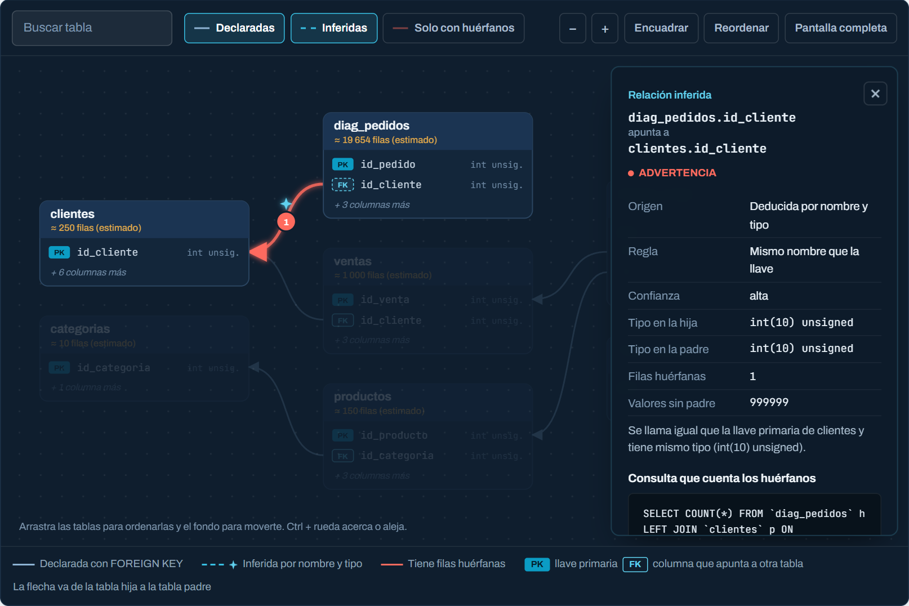
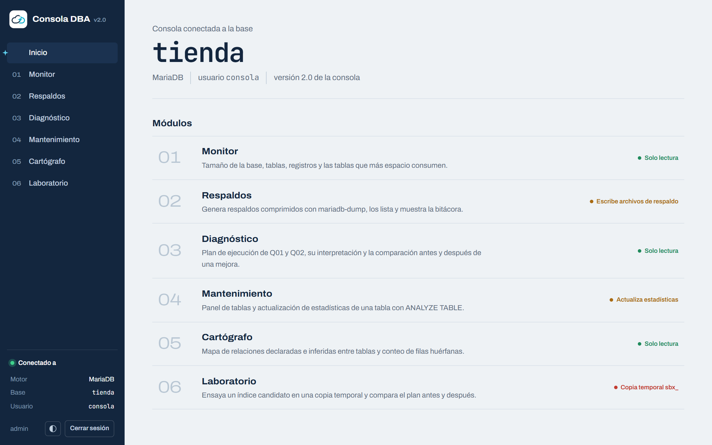
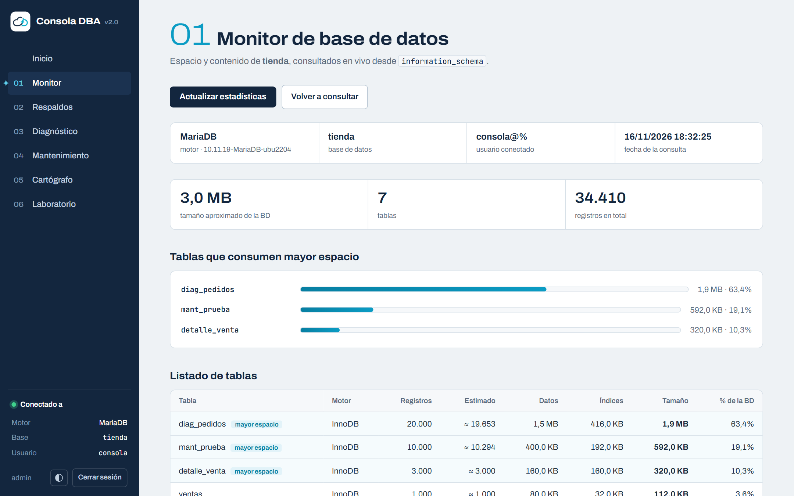
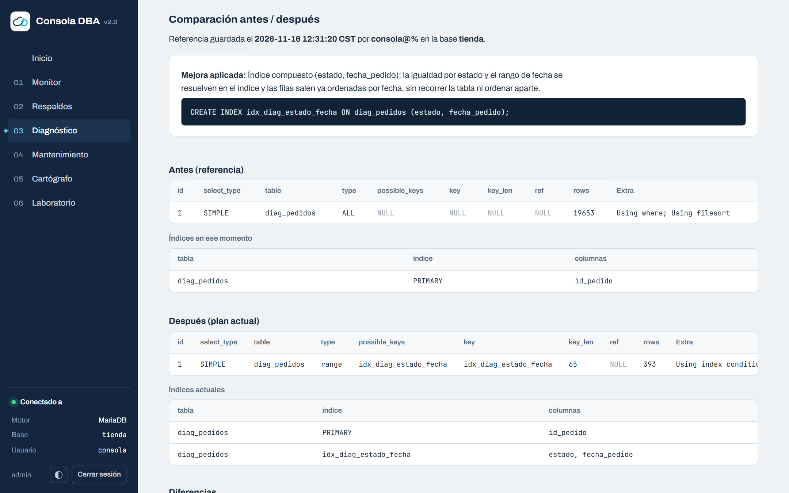
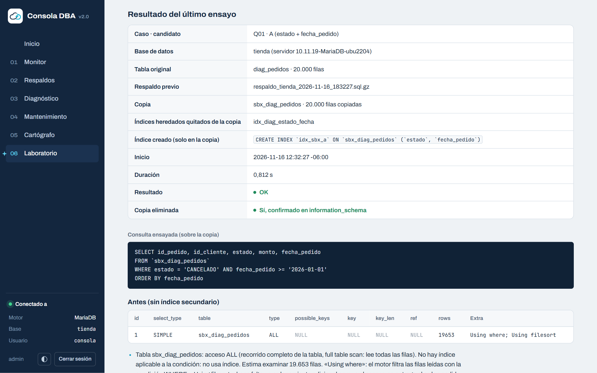
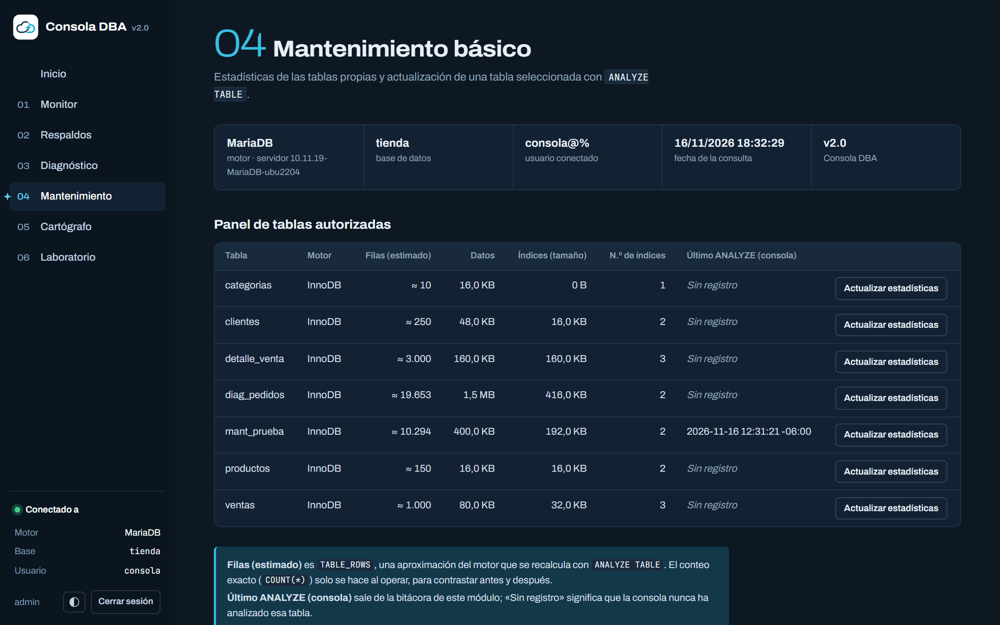

# Consola DBA — consola de administración para MariaDB

Consola web para administrar una base MariaDB desde una **cuenta de hosting compartido sin acceso root**:
monitorear el espacio, generar respaldos validados, leer y comparar planes de ejecución, actualizar las
estadísticas del optimizador, mapear las relaciones entre tablas y ensayar índices candidatos sobre copias temporales.

Desarrollada por un equipo de cuatro personas para el curso *Administración de Bases de Datos* de la Universidad Nacional de Costa Rica (2026).

*[English version](README.md)*



## Ejecutarla en local

Requiere Docker.

```bash
git clone https://github.com/SantiagoAzofeifa/Proyecto_Admin_Bases.git
cd Proyecto_Admin_Bases
docker compose up --build
```

Abrir <http://localhost:8080> e ingresar con `admin` / `demo2026` (credenciales solo para la demo).
La base arranca con los datos de prueba del proyecto: una tienda pequeña y 20 000 pedidos generados.

## Módulos

| # | Módulo | Qué hace | Efecto sobre la base |
|---|---|---|---|
| 01 | Monitor | Tamaño de la base, tablas, filas exactas y estimadas, datos e índices, tablas más grandes | Solo lectura |
| 02 | Respaldos | `mariadb-dump` + gzip mediante un script Bash; valida cada archivo y registra OK/ERROR | Escribe respaldos |
| 03 | Diagnóstico | `EXPLAIN` en vivo de un catálogo cerrado de consultas, interpretación, plan «antes» guardado y comparación antes/después con resultados equivalentes | Solo lectura |
| 04 | Mantenimiento | Panel de estadísticas y `ANALYZE TABLE` sobre una tabla autorizada, con confirmación, `COUNT(*)` antes y después, y bitácora | Actualiza estadísticas |
| 05 | Cartógrafo | Llaves foráneas declaradas y relaciones **inferidas** por nombre y tipo; cuenta filas huérfanas; diagrama ER interactivo | Solo lectura |
| 06 | Laboratorio | Copia la tabla a `sbx_*`, crea el índice candidato en la copia, compara los planes y siempre elimina la copia | Solo una copia temporal |

| | |
|---|---|
|  |  |
|  |  |

## Decisiones técnicas

**Restricciones reales.** Corre en una cuenta de Virtualmin compartida: sin root, sin sudo, sin privilegios globales
y con una base por estudiante. Todo es PHP, SQL y Bash ejecutado con el usuario de la cuenta.

**Seguridad**
- Acceso con `password_hash` / `password_verify`, regeneración de sesión, cierre por inactividad y token CSRF en cada acción.
- Sin SQL libre: consultas, tablas, casos y candidatos salen de catálogos cerrados en el servidor; los identificadores
  se validan contra `information_schema` y se escapan, y los valores van en sentencias preparadas.
- Secretos fuera de la carpeta web (`~/dba_config/dba.conf`, permisos 600). La clave llega a `mariadb-dump` por
  `MYSQL_PWD`, así no aparece en la lista de procesos.
- POST → Redirect → GET en toda acción que modifica algo; los errores nunca muestran credenciales.

**Confiabilidad**
- Cada respaldo se escribe en un `.partial` y solo se acepta si pasan `pipefail`, `gzip -t` y la marca `Dump completed`; `flock` evita ejecuciones simultáneas.
- El laboratorio es el único módulo con DDL: tiene bloqueo (un ensayo a la vez), respaldo previo obligatorio,
  límite de filas y tres capas de limpieza para que nunca quede una copia.
- Los conteos de huérfanos tienen tiempo máximo por consulta (`max_statement_time`) y muestran «No disponible» en vez de un cero engañoso.

**Portabilidad.** Todo lo que cambia entre cuentas vive en un único `dba.conf` que leen PHP y Bash.
El mismo código se instaló y probó en la cuenta de otro integrante cambiando solo ese archivo.

**Interfaz.** PHP renderizado en el servidor, sin framework; sistema de diseño con tema claro y oscuro; diagrama ER interactivo
en JavaScript puro (arrastrar, acercar, buscar, filtrar y panel con el SQL de cada comprobación), con un SVG del servidor como respaldo sin JavaScript.



## Tecnologías

PHP 8 (PDO), MariaDB 10.11 (`information_schema`, `EXPLAIN`, `ANALYZE TABLE`), Bash, Apache, JavaScript y SVG, CSS,
permisos de archivos en Linux, Docker (demo local), Git/GitHub con ramas por tarea y pull requests.

## Instalación en hosting compartido

1. Copiar los archivos PHP, `includes/`, `css/`, `js/` e `img/` a una carpeta dentro de `~/public_html/`.
2. Ejecutar `bash grupo3_novacloud/tools/crear_estructura.sh` para crear las carpetas privadas con sus permisos; luego copiar `grupo3_novacloud/config/dba.conf.ejemplo` a `~/dba_config/dba.conf` (permisos 600) y completarlo.
3. Copiar `grupo3_novacloud/scripts/backup.sh` a `~/dba_scripts/` (permisos 700) y cargar `grupo3_novacloud/db/bd_prueba.sql`.
4. Verificar la cuenta con `bash grupo3_novacloud/tools/verificar_entorno.sh`.

La documentación técnica de cada módulo está en `grupo3_novacloud/docs/`.

## Pruebas

```bash
php grupo3_novacloud/tools/probar_santiago_05_06.php   # inferencia de relaciones y motor del laboratorio
php grupo3_novacloud/tools/probar_gabriel_05.php      # conteo de huérfanos, límites y bitácora
php grupo3_novacloud/tools/probar_gabriel_06.php      # bloqueo, respaldo previo y limpieza garantizada
```

## Equipo

| Integrante | Aportes principales |
|---|---|
| **Santiago Azofeifa Benavides** ([@SantiagoAzofeifa](https://github.com/SantiagoAzofeifa)) | Monitor (01); pantalla de diagnóstico con interpretación de planes y comparación antes/después (03); motor de inferencia de relaciones (05); motor de ensayo del laboratorio (06); integración v2.0; rediseño de la interfaz y mapa ER interactivo; demo con Docker y documentación |
| **Karen Avilés López** ([@KarenAvlo](https://github.com/KarenAvlo)) | Base de prueba y generación de datos, configuración central, scripts de preparación de cuentas, catálogo de consultas y ensayo de índice (03), lector del catálogo y candidatos de índice (05, 06) |
| **Gabriel Quirós Villalobos** ([@GabeQV](https://github.com/GabeQV)) | Respaldos y `backup.sh` (02), mantenimiento (04), conteo de huérfanos con límites y bitácora (05), bloqueo, respaldo previo y limpieza garantizada (06) |
| **Andy José Luna Izaguirre** ([@Armoon01](https://github.com/Armoon01)) | Autenticación y sesiones, menú y estructura común, pantallas del Cartógrafo y del Laboratorio con SVG del servidor (05, 06), pruebas en segunda cuenta |

Proyecto académico del curso *Administración de Bases de Datos*, Escuela de Informática, Universidad Nacional de Costa Rica (2026).
