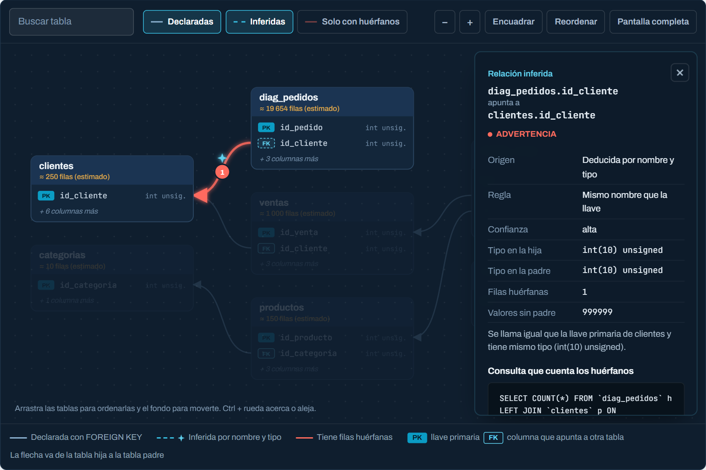
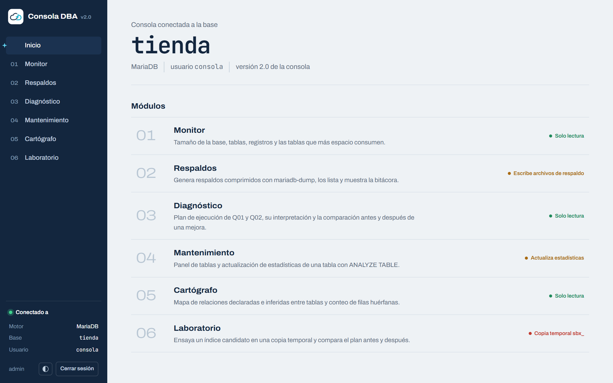
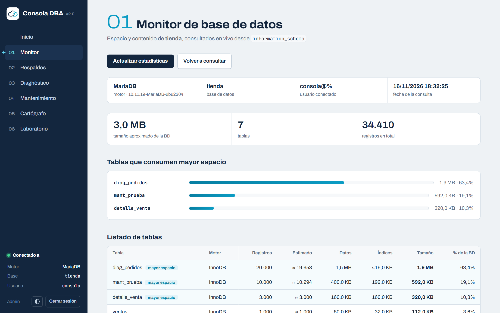
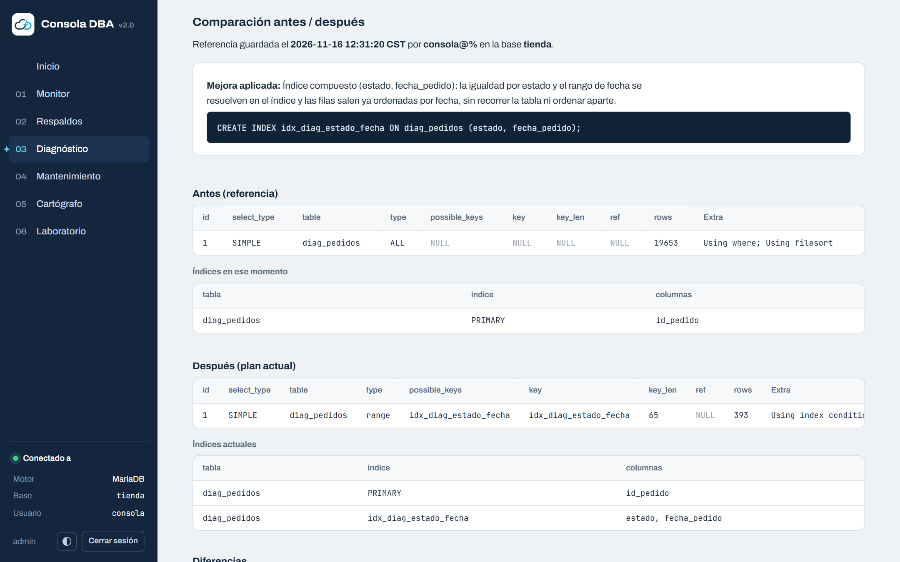
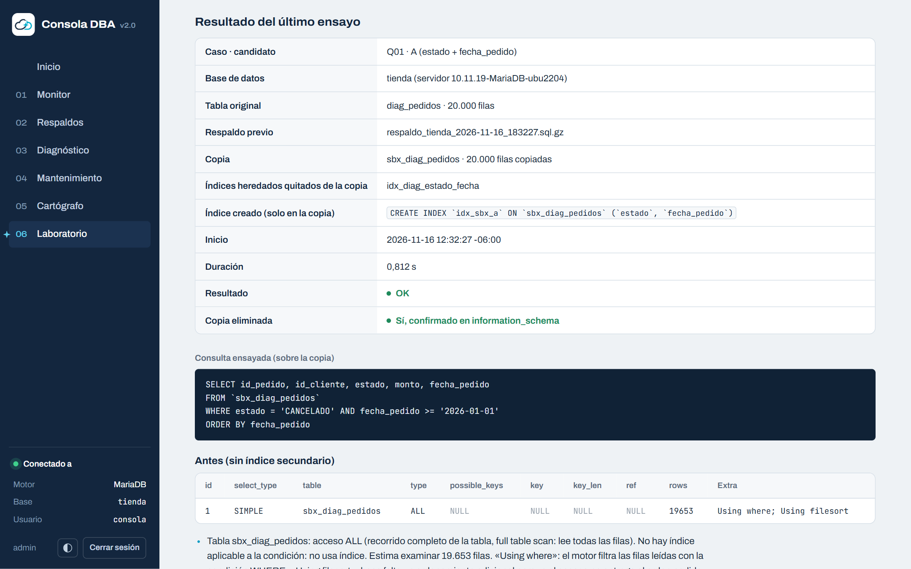
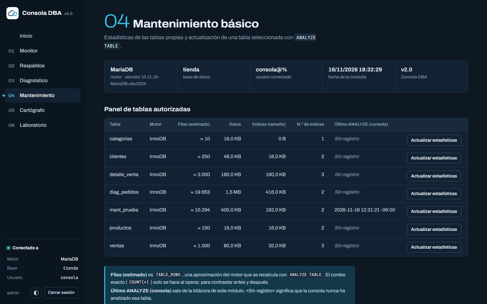
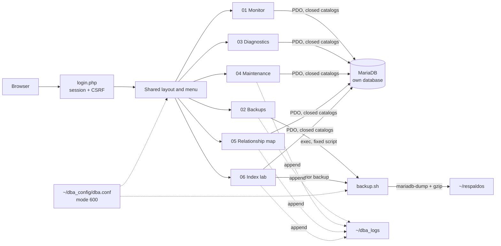

# Consola DBA — MariaDB administration console

A web console for administering a MariaDB database from a **shared hosting account with no root access**:
monitor storage, take validated backups, read and compare query plans, refresh optimizer statistics,
map table relationships, and test index candidates safely on temporary copies.

Built by a four-person team for the *Database Administration* course at Universidad Nacional de Costa Rica (2026).

*[Versión en español](README.es.md)*



## Run it locally

Requires Docker.

```bash
git clone https://github.com/SantiagoAzofeifa/Proyecto_Admin_Bases.git
cd Proyecto_Admin_Bases
docker compose up --build
```

Open <http://localhost:8080> and sign in with `admin` / `demo2026` (demo-only credentials).
The database starts with the project's sample data: a small store schema plus 20,000 generated orders.

## Modules

| # | Module | What it does | Effect on the database |
|---|---|---|---|
| 01 | Monitor | Database size, tables, exact vs. estimated rows, data vs. index size, largest tables | Read only |
| 02 | Backups | `mariadb-dump` + gzip through a hardened Bash script; validates every file and logs OK/ERROR | Writes backup files |
| 03 | Query diagnostics | Live `EXPLAIN` for a closed catalog of queries, plain-language interpretation, saved "before" plan and before/after comparison with result equivalence | Read only |
| 04 | Maintenance | Statistics panel and `ANALYZE TABLE` on one authorized table, with confirmation, `COUNT(*)` before/after and a log | Refreshes statistics |
| 05 | Relationship map | Declared foreign keys plus relationships **inferred** by column name and type; counts orphan rows per relationship; interactive ER diagram | Read only |
| 06 | Index lab | Copies a table to `sbx_*`, builds a candidate index on the copy, compares plans, and always drops the copy | Temporary copy only |

| | |
|---|---|
|  |  |
|  |  |

## Engineering highlights

**Built under real constraints.** It runs on a shared Virtualmin account: no root, no sudo, no global privileges,
one database per student. Everything is PHP, SQL and Bash executed as the account owner.

**Security**
- Console login with `password_hash` / `password_verify`, session regeneration, inactivity timeout and CSRF tokens on every action.
- No free-form SQL anywhere. Queries, tables, cases and index candidates come from closed server-side catalogs;
  identifiers are validated against `information_schema` and escaped, values go through prepared statements.
- Secrets live outside the web root (`~/dba_config/dba.conf`, mode 600). The database password reaches `mariadb-dump`
  through `MYSQL_PWD`, so it never appears in the process list.
- POST → Redirect → GET on every state-changing action; error messages never include credentials.

**Reliability**
- Backups are written to a `.partial` file and only accepted after `pipefail`, `gzip -t` and the `Dump completed` marker pass; `flock` prevents concurrent runs.
- The index lab is the only module that runs DDL, so it has a lock (one trial at a time), a mandatory backup first,
  a row limit, and three cleanup layers (`finally`, reconnect-and-drop, shutdown handler) so a copy is never left behind.
- Relationship checks run with per-query timeouts (`max_statement_time`) and report "not available" instead of a misleading zero.

**Portability.** All account-specific values (host, database, user, paths, version) live in a single `dba.conf` read by both PHP and Bash.
The same code was deployed and tested on a second team member's account by changing only that file.

**Interface.** Server-rendered PHP with no framework; a design system with light and dark themes; an interactive ER diagram
in vanilla JavaScript (drag, zoom, search, filters, detail panel with the SQL behind each check) that falls back to a server-rendered SVG without JavaScript.



## Architecture



## Tech stack

PHP 8 (PDO), MariaDB 10.11 (`information_schema`, `EXPLAIN`, `ANALYZE TABLE`), Bash, Apache, vanilla JavaScript and SVG, CSS,
Linux file permissions, Docker (local demo), Git/GitHub with feature branches and pull requests.

## Project structure

```
├── *.php                     # One page per module + login, logout, home
├── includes/                 # Logic per module, catalogs, shared layout and auth
├── css/estilos.css           # Design system (tokens, light and dark themes)
├── js/                       # Theme switcher and the interactive relationship map
├── docker/, docker-compose.yml
├── docs/capturas/            # Screenshots
└── grupo3_novacloud/
    ├── config/dba.conf.ejemplo   # Configuration template
    ├── db/                       # Schema, sample data and test scripts (SQL)
    ├── scripts/backup.sh         # Backup script used by modules 02 and 06
    ├── tools/                    # Account setup, environment check, CLI test suites
    └── docs/                     # Technical notes per module (Spanish)
```

## Deploying on shared hosting

1. Copy the PHP files, `includes/`, `css/`, `js/` and `img/` to a folder inside `~/public_html/`.
2. Run `bash grupo3_novacloud/tools/crear_estructura.sh` to create the private folders with the right permissions, then copy `grupo3_novacloud/config/dba.conf.ejemplo` to `~/dba_config/dba.conf` (mode 600) and fill it in.
3. Copy `grupo3_novacloud/scripts/backup.sh` to `~/dba_scripts/` (mode 700) and load `grupo3_novacloud/db/bd_prueba.sql`.
4. Check the account with `bash grupo3_novacloud/tools/verificar_entorno.sh`.

## Tests

Command-line suites that exercise the real database:

```bash
php grupo3_novacloud/tools/probar_santiago_05_06.php   # relationship inference + index lab engine
php grupo3_novacloud/tools/probar_gabriel_05.php      # orphan counting, limits, logging
php grupo3_novacloud/tools/probar_gabriel_06.php      # locking, prior backup, guaranteed cleanup
```

## Team

| Member | Main contributions |
|---|---|
| **Santiago Azofeifa Benavides** ([@SantiagoAzofeifa](https://github.com/SantiagoAzofeifa)) | Monitor (01); query-diagnostics screen with plan interpretation and before/after comparison (03); relationship inference engine (05); index-lab trial engine (06); v2.0 integration; UI redesign and interactive ER map; Docker demo and documentation |
| **Karen Avilés López** ([@KarenAvlo](https://github.com/KarenAvlo)) | Sample database and data generation, central configuration, account setup scripts, query catalog and index trial (03), catalog reader and index candidates (05, 06) |
| **Gabriel Quirós Villalobos** ([@GabeQV](https://github.com/GabeQV)) | Backups and `backup.sh` (02), maintenance (04), orphan counting with limits and logs (05), locking, prior backup and guaranteed cleanup (06) |
| **Andy José Luna Izaguirre** ([@Armoon01](https://github.com/Armoon01)) | Authentication and sessions, shared menu and layout, relationship-map and index-lab screens with server-side SVG (05, 06), second-account deployment tests |

Academic project for *Administración de Bases de Datos*, Escuela de Informática, Universidad Nacional de Costa Rica (2026).
